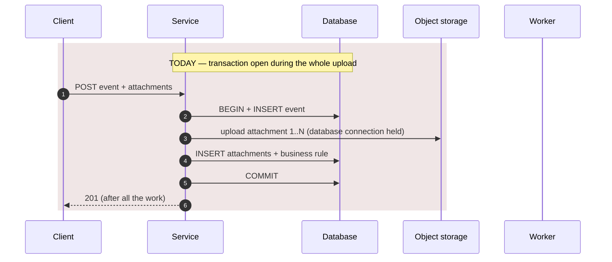
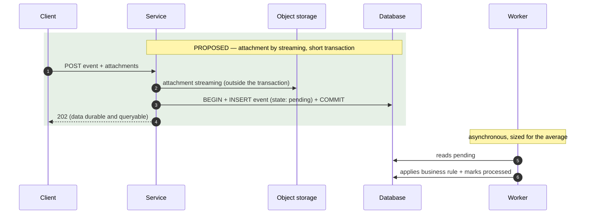

# Deliverables

Four artifacts — technical report, decision summary, plan and ADRs — for **two
audiences**. Confirm the destination with the user
before writing — default `docs/performance/` in the analyzed repository.

**Language.** Every deliverable is written in the user's language, not the
language of this skill. The templates below give their headings in English;
render every heading, label, table column and file name in the user's language.
File names follow the same rule — for a Portuguese-speaking user they are
`analise-…`, `resumo-decisao-…` and `plano-tuning-…`:

```
docs/performance/
├── analysis-<YYYY-MM-DD>.md           # technical: for those who implement and review   (pt: analise-<AAAA-MM-DD>.md)
├── decision-summary-<YYYY-MM-DD>.md   # managerial: for those who authorize             (pt: resumo-decisao-<AAAA-MM-DD>.md)
├── tuning-plan-<YYYY-MM-DD>.md        # execution order, metric and rollback            (pt: plano-tuning-<AAAA-MM-DD>.md)
└── adr/
    ├── 001-<decision>.md
    └── 002-<decision>.md
```

Diagrams go in Mermaid inside the reports themselves — no external
dependency to render. If the user asks for a single file to circulate,
generate `PERFORMANCE-REPORT-<date>.md` (pt: `RELATORIO-PERFORMANCE-<data>.md`)
by concatenating the four, with a notice at the top pointing to the structured
files as the source. Never edit the consolidated one; regenerate it.

## Index
- [1. Technical report](#1-technical-report)
- [2. Decision summary](#2-decision-summary)
- [3. Tuning plan](#3-tuning-plan)
- [4. ADR per architectural decision](#4-adr-per-architectural-decision)
- [5. Diagrams](#5-diagrams)

## 1. Technical report

File: `docs/performance/analysis-<YYYY-MM-DD>.md` (pt: `analise-<AAAA-MM-DD>.md`)

Reader: whoever will implement, review and disagree based on evidence.
This is where file and line go, the full arithmetic, the command that produced
each number. It is the **source of truth**: the decision summary points to it.

```markdown
# Performance Analysis — <system> — <date>

**Scope:** <services/versions>. **Environment:** <cluster/namespace>.
**Stance:** read-only — nothing was changed.

## Executive summary

Five lines, at most. The goal, the verdict (meets / does not meet / cannot be
stated), the main bottleneck, the highest-impact change, and what has not
been measured yet. Followed by the **proposal in a table**:

| # | Problem | Action | Quantity / sizing | When |
|---|---|---|---|---|

This is the table the reader looks for. Each row is an executable action
("go from 1 to 4 replicas with `requests` 1 Gi / 500m", "create an index on
(plate, date)", "move processing into its own consumer", "publish with
confirm before responding"), not a category ("improve the database").

## Goal, target and SLO

Primary goal and constraints. Then the table:

| Item | Value | Origin |
|---|---|---|
| Current volume/day | | measured (source) / declared |
| Target volume/day | | declared |
| Average req/s | | calculated |
| Hourly peak factor | | measured / assumption (table) |
| Burst factor (1 s) | | measured / assumption |
| Design peak req/s | | calculated (factor X, headroom Y) |
| Target response time | | declared / assumption |
| Loss tolerance | | declared / assumption |
| "Queryable" window | | declared / assumption |
| Constraints | | declared |

### Full arithmetic

The whole calculation, not only the result — whoever reviews needs to be able
to disagree with the peak factor. Storage by retention and database growth
when there is persisted data; records/s for batch; cost per request for cost.

## System map and current scenario

Components on the goal's path, named as in the repository; external
dependencies; **what is shared between replicas**. Today's request flow
(diagram), with the slow step marked. Current infrastructure (replicas,
resources, probes, HPA, measured real usage).

## Bottlenecks

| # | Bottleneck | Type | Evidence | Impact on target | Effort |
|---|---|---|---|---|---|

Only items with evidence go in. `Type` is root cause or aggravating factor; a
plausible but unconfirmed hypothesis goes in the next table, never here.

### Unverified hypotheses

| Hypothesis | Why it is plausible | Measurement that confirms it |
|---|---|---|

This section is not an appendix — it is what separates analysis from guessing.
If it is empty, great; if it is full, the first item of the plan is
instrumentation.

### Out-of-scope findings

Functional defect found in passing (NPE, unreadable log, a bug that is not
performance). One line per item, with file and line. It does not go in the
bottleneck table.

## Target architecture

### What does not change — and why
Table. As important as what changes: it is what prevents "rewrite everything".

### What changes — solution proposal
Proposed diagram. Then, the full table:

| # | Problem (bottleneck #) | Action | Sizing and assumption | ADR | Effort |
|---|---|---|---|---|---|

Table rules:
- **Every action is quantified.** Replicas with the calculation (`peak ÷
  capacity per replica + 1`), `requests`/`limits` with the measured usage that
  justifies them, pool size by Little's Law, cache TTL by how often the data
  changes, queue cap by what fits in memory.
- **Assumption declared where the measurement is missing.** "4 replicas
  (assumption: 100 req/s per replica; confirm in plan item 0.6 — if it is 50,
  it is 7)". The proposal exists today; the measurement corrects it later.
- **A hypothesis also gets an action**, conditional: "if the trace confirms
  serialization in the ID generator → sequence with cache 1000; if not →
  nothing".
- **New components appear as such**: "create service X", "add Redis", "create
  queue Y" — with the numeric reason and the operational cost in the cost
  table.
- Nothing ends in "evaluate", "study" or "measure" without the action that
  follows each possible result.

## Costs

| Item | Cost | Note |
|---|---|---|

Storage, license, node, operational complexity, people to operate it.

## Risks and what remains open

Risks **of the proposed change** (not of the current system) with mitigation;
decisions that depend on business/legal; what was left unmeasured, numbered.

## Evidence inventory

| # | Source | When | How (command / query / file) | What it showed |
|---|---|---|---|---|

And, below it: **sources offered and not used**, with the reason (no access,
`403`, metrics-server missing, user skipped).
```

## 2. Decision summary

File: `docs/performance/decision-summary-<YYYY-MM-DD>.md` (pt: `resumo-decisao-<AAAA-MM-DD>.md`)

Reader: whoever authorizes budget, deadline and priority, and **will not read
code**. One to two pages. It is not the technical report summarized — it is a
different document, written for a different question: *"what do I need to
decide, why, and what happens if I don't decide"*.

Rules for this document:

- **Zero** file names, lines, commands, code snippets, class names.
- **Zero** acronyms or technical terms without an explanation in the same
  sentence. Use the translation table below.
- Numbers **rounded** (two significant digits) and **always with a
  comparison** ("200 times today's volume", "the equivalent of 4 years of
  photos from the whole agency"). A range appears as a range, with the reason
  for the uncertainty ("between 0.6 and 7 petabytes, because nobody has
  measured the image size yet").
- **Every number exists in the technical report.** Nothing new here. A footer
  points to the technical report as the source.
- An analogy is welcome when it explains a mechanism (the "receipt before
  storing" explains durability better than any term).
- It starts with what **is right**. Whoever reads "we need to change 20
  things" concludes "rewrite"; whoever reads "6 decisions are right and 5 need
  adjustment" concludes "adjust".
- One simple diagram is allowed (4 to 6 boxes, `flowchart`), with no internal
  component names — "radar", "intake", "queue", "database".

```markdown
# <System> — what to decide before <goal in business language>

<Two or three sentences of context: what is going to happen in the business,
in what order of magnitude, and what this document answers.>

## Verdict

<One sentence in bold: meets / does not meet / cannot be stated yet — and
why, in business language.> <One paragraph: what the central problem is and
why the fix is bigger or smaller than it looks.>

| <N> | <N> | <N> |
|---|---|---|
| already failing today | must change before the volume | right decisions to keep |

## What is already right and we will keep

<One entry per kept decision: short title + one paragraph saying why changing
it would be expensive and would solve nothing.>

## The central problem, explained

<An image or analogy; optionally a "today" vs "proposed" flowchart with few
boxes. The reader must leave here understanding the mechanism, not its name.>

## What needs to change

<3 to 7 items. Each one: what changes (one concrete sentence: "go from one to
four copies of the intake service", "create a separate service for the
infraction calculation"), why (one sentence), when (before/after turning on
the volume), effort in order of magnitude (days, weeks, a quarter). No code.
The reader leaves here knowing what will be done, not only what is wrong.>

## What only management can decide

<Data retention, budget, contract with supplier/vendor, deadline, priority
between goals. For each one: the question, the options, what each option
costs in order of magnitude.>

## What we don't know yet — and how we will find out

<Pending measurements in plain language, each one with what it decides and
how long it takes. It is what keeps the verdict honest.>

## Where to start

<The first three actions, in order, with what changes when each one is done
and how long it takes.>

## The numbers that decide

| Number | Value | What it means |
|---|---|---|
<Up to five rows, rounded, each with one sentence of meaning.>

---
Based on: `analysis-<date>.md` (technical report, with evidence and method).
```

### Technical → managerial translation table

It is not a closed list; it is the pattern for how to translate. Write the
right-hand column in the user's language.

| In the technical report | In the decision summary |
|---|---|
| p95 of 300 ms | 19 out of every 20 responses in under a third of a second |
| p99 | the slowest response out of every hundred |
| req/s, throughput | passages (requests, documents) per second |
| `OOMKilled`, restart | the service ran out of memory and was restarted by the environment; what was in progress was lost |
| exhausted connection pool | all the database access slots taken; new requests wait |
| long transaction / I/O in the transaction | holding the database slot while doing something else (sending the image, calling another system) |
| idempotency | receiving the same request twice does not create two records |
| durability before the response | only saying "received" after storing |
| replica / horizontal scaling | copies of the service running in parallel |
| HPA | copies added and removed automatically according to demand |
| `requests`/`limits` | reservation and ceiling of resources for each copy |
| backpressure, `429`/`503` | saying "I'm full, try again in 30 s" instead of accepting and losing |
| queue / broker | the queue that absorbs the burst so processing consumes it at its own pace |
| object storage | the file warehouse, separate from the database |
| partitioning | splitting the table by month so that deleting the old part is instantaneous |
| index | the "book index" that avoids reading every page to find one plate |
| cache | keeping the ready answer so it is not recalculated on every request |
| ADR | decision record (what was decided, what was discarded, why) |
| quick win | quick adjustment, with no structural change |
| unverified hypothesis | suspicion not yet confirmed by measurement |
| SLO | the performance commitment we will measure and hold ourselves to |
| burst factor | how many times the worst fraction of a second exceeds the average |

## 3. Tuning plan

File: `docs/performance/tuning-plan-<YYYY-MM-DD>.md` (pt: `plano-tuning-<AAAA-MM-DD>.md`)

Four blocks in execution order (numbered Block 0–3 so they are not confused
with the workflow phases). Each item has a validation metric and a rollback
criterion — an item without a metric is not a plan, it is an intention.

```markdown
# Tuning Plan — <system> — <date>

Target: <one line>. Measured baseline: <one line>. **Nothing was applied.**

## Block 0 — Instrumentation and measurement

Exists only if there is an open hypothesis — and there almost always is. It is
the phase with the highest information return per effort.

| # | Measurement | Where | Hypothesis it resolves | Effort |
|---|---|---|---|---|

## Block 1 — Quick wins (configuration and tuning, no architecture change)

| # | Change | Where | Bottleneck | Metric that validates | Rollback | Effort |
|---|---|---|---|---|---|---|

### Blocks for review
Each change as code/command/YAML/SQL, commented, for the team to apply.
Prerequisites and caveats as a note below the block.

## Block 2 — Structural changes

| # | Change | ADR | Where | Metric that validates | Rollback | Effort |
|---|---|---|---|---|---|---|

Each item references the ADR that decided it.

## Block 3 — Optional (only if the number requires it)

| # | Change | Trigger that justifies it | Effort |
|---|---|---|---|

The "trigger" is the number that, once reached, makes the item necessary.
Without a trigger, the item should not be in the plan. A technology the user
asked for and the number does not support goes here, with "no trigger of X
justifies it" and the architectural reason that would justify it.

## Summarized execution order

A text diagram: blocks, duration in order of magnitude, what each one
unlocks.
```

The order is not negotiable: instrumentation before optimization, quick win
before structural change. A plan that starts by rewriting the service is a
plan that will never be executed.

## 4. ADR per architectural decision

File: `docs/performance/adr/NNN-<decision-in-kebab-case>.md`

One ADR per decision that is hard to reverse later. If the decision is
trivial to change, it does not need an ADR. A decision **conditional on
measurement** ("keep X for now; switch if the test shows Y") is also an ADR —
and one of the most useful, because it prevents switching on intuition.

```markdown
# ADR NNN — <decision>

- **Date:** <YYYY-MM-DD>
- **Status:** proposed | accepted | discarded | conditional on measurement | superseded by ADR NNN

## Context
The problem and the number that makes it a problem. Without the number, there
is no decision to make.

## Decision
What will be done, in one or two sentences. If conditional: the trigger.

## Discarded alternatives
| Alternative | Why it was discarded |
|---|---|
Include "do nothing" whenever it is defensible — in half the cases it is, and
the ADR is more honest for saying why not. Include the alternative that
violates a user constraint, saying which one.

## Consequences
What gets better, what gets worse, what starts requiring operation or
monitoring that did not exist before.

## Cost
Financial, operational and complexity.
```

## 5. Diagrams

At least two diagrams in the technical report:

1. **Current flow** — what happens today between the client and the
   persisted data.
2. **Proposed flow** — the same path after the changes.

Both must show, explicitly, four things — without them the diagram helps
decide nothing, it is a drawing of boxes:

- the **transactional boundary** (what is atomic with what);
- **where the attachment goes** (database, heap, external storage) — when
  there is one;
- **what is synchronous and what is asynchronous**;
- **where the data becomes queryable** (or, for reads, **where the response
  comes from**: cache, replica, database).

Use `sequenceDiagram` when the point is *when* each thing happens and what
holds the response:





Use `flowchart` when the point is the **topology** — components, replicas,
where the data rests — and it is the format of the decision summary diagram.
A third deployment diagram (replicas, HPA, database, storage) is worth it when
the proposal changes the scale.

Rules so the diagrams do not lie:

- In the technical report, name the components as they are called in the
  repository. In the managerial one, by role ("intake", "queue", "database").
- Mark on the current diagram **where the time is spent** (the slow step), not
  only the order of the calls.
- If something in the diagram is a hypothesis (a flow you could not confirm in
  the code), say so in the caption below the block.
